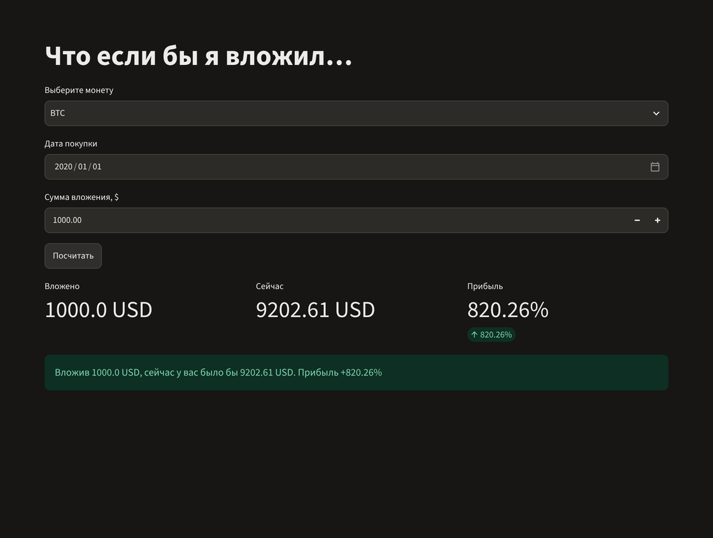
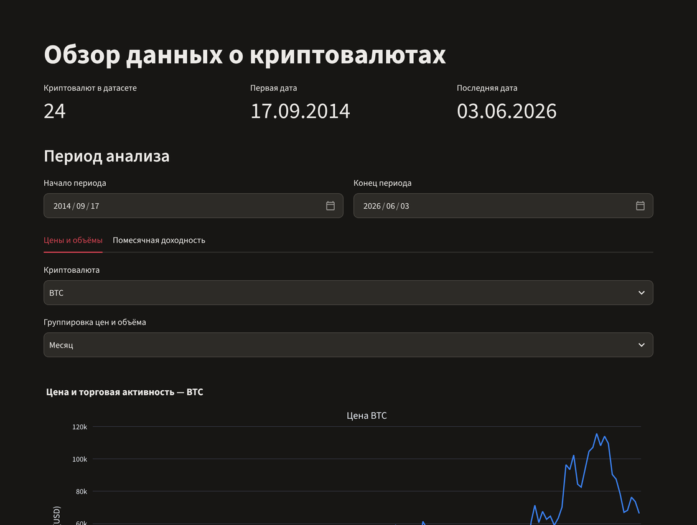
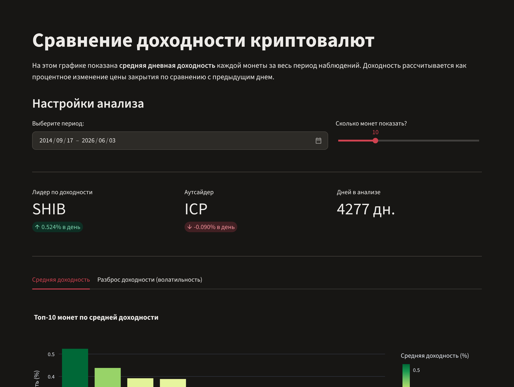
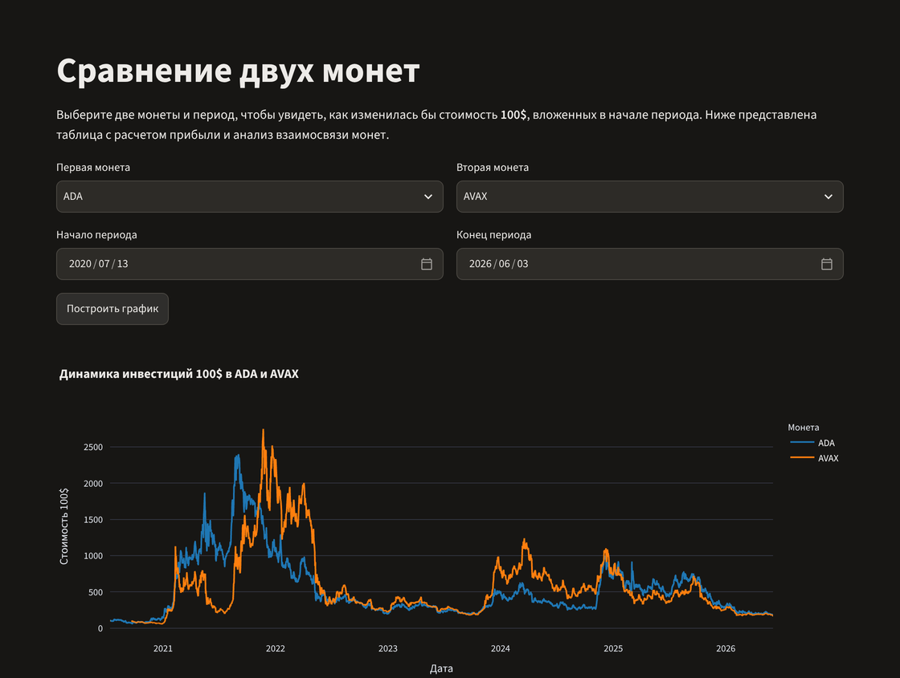
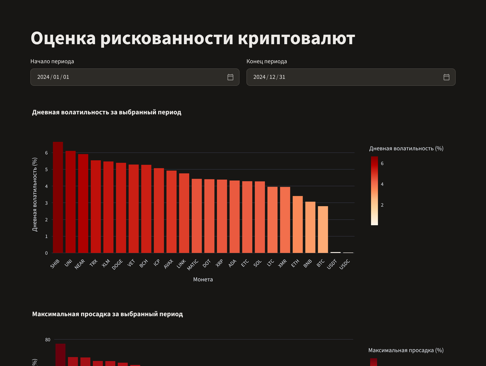

# Анализ криптовалют — Team 12

Веб-приложение на Streamlit для анализа исторических цен 24 криптовалют: доходность, риск, сравнение двух монет и калькулятор «Что если бы я вложил…».

Итоговый проект по дисциплине «Разработка программных средств», РАНХиГС, 2026.



---

## Цель и задачи

**Цель** — дать человеку без навыков программирования простой инструмент: сравнить криптовалюты по доходности и риску и посчитать, что стало бы с его вложением.

**Задачи:**

1. Загрузить исторические цены и очистить их от ошибок.
2. Посчитать среднюю дневную доходность каждой монеты.
3. Оценить риск: волатильность и максимальную просадку.
4. Сравнить любые две монеты между собой.
5. Сделать калькулятор вложений.
6. Проверить расчёты автотестами.
7. Собрать всё в одно веб-приложение.

## Возможности

В меню слева пять разделов:

| Раздел | Что показывает |
|---|---|
| **Обзор данных** | Сколько монет и за какой период есть в данных, график цены и объёма торгов выбранной монеты, тепловая карта помесячной доходности |
| **Сравнение доходности** | Лидер и аутсайдер по средней дневной доходности, топ монет на графике, разброс доходности, таблица с выгрузкой в CSV |
| **Сравнение двух монет** | Во что превратились бы 100 $, вложенные в каждую из двух монет, итоговая таблица с прибылью и корреляцией, выгрузка в CSV |
| **Оценка рискованности** | Дневная волатильность и максимальная просадка всех монет за выбранный период, топ‑5 монет с наибольшими и наименьшими волатильностью и просадкой |
| **«Что если бы я вложил…»** | Сколько стоили бы ваши вложения сейчас: выбираете монету, дату покупки и сумму — получаете итог и прибыль в % |

## Установка и запуск

Нужен Python 3.10 или новее.

```bash
# 1. Скачать проект
git clone https://github.com/YanaSimilidi/team-12-crypto-data-analytics.git
cd team-12-crypto-data-analytics

# 2. Создать и включить виртуальное окружение
python3 -m venv venv
source venv/bin/activate          # Windows: venv\Scripts\activate

# 3. Установить библиотеки
pip install -r requirements.txt

# 4. Запустить приложение
python -m streamlit run app.py
```

После запуска браузер сам откроет страницу `http://localhost:8501`. Если не открыл — перейдите по этому адресу вручную.

**Как понять, что всё работает:** слева появится меню «Навигация по проекту» с пятью разделами, а в разделе «Обзор данных» — карточки «Криптовалют в датасете: 24», «Первая дата: 17.09.2014», «Последняя дата: 03.06.2026».

Файл с данными уже лежит в репозитории: `data/historical_crypto_data.csv`. Если его нет, приложение покажет сообщение о том, где он должен лежать.

## Входные и выходные данные

### На входе

Таблица `data/historical_crypto_data.csv` с дневными ценами (датасет с Kaggle): 68 427 строк, 24 монеты, с 17.09.2014 по 03.06.2026.

```text
Date,Symbol,Coin_Name,Open,High,Low,Close,Volume
2014-09-17,BTC-USD,BTC,465.86,468.17,452.42,457.33,21056800
2014-09-17,LTC-USD,LTC,5.09,5.17,4.97,5.06,3071840
```

Плюс то, что выбирает пользователь: монету, период, количество монет на графике, сумму вложения.

### На выходе

Интерактивные графики, таблицы и карточки с итогами, выгрузка таблиц в CSV и журнал работы `app.log`.

**Пример — калькулятор «Что если бы я вложил…»:**

| Ввод | Результат |
|---|---|
| Монета: **BTC**, дата покупки: **01.01.2020**, сумма: **1000 USD** | Сейчас: **9202.61 USD**, прибыль **+820.26 %** |
| Монета: **ADA**, дата покупки: **01.01.2018**, сумма: **800 USD** | Сейчас: **230.56 USD**, убыток **−71.18 %** |
| Монета: **ICP**, дата покупки: **01.01.2018** | Предупреждение: «На эту дату нет цены этой монеты» — ICP появилась только в 2021 году |

«Сейчас» — это последний день в данных (03.06.2026). У MATIC данные заканчиваются 24.03.2025: монету переименовали, поэтому для неё берётся последняя доступная цена.

## Скриншоты

| Обзор данных | Сравнение доходности |
|---|---|
|  |  |

| Сравнение двух монет | Оценка рискованности |
|---|---|
|  |  |

## Подготовка данных

Функция `load_data()` в `utils/data_loader.py` один раз очищает таблицу перед всеми расчётами:

- удаляет строки, где хотя бы одна из цен (Open, High, Low, Close) пустая, нулевая или отрицательная — например, у SHIB в 2020–2021 годах цены были нулевыми;
- переименовывает монету `UNI7083` в `UNI`;
- переводит столбец с датами в формат дат.

Данные загружаются один раз и запоминаются (`st.cache_data`), поэтому разделы переключаются быстро.

## Тесты и стиль кода

```bash
python -m pytest      # автотесты: 15 тестов
flake8 .              # проверка стиля по PEP 8
black .               # автоматическое выравнивание кода
```

Тесты лежат в папке `tests/` — по файлу на каждый модуль расчётов. Они считают на маленьких таблицах, где правильный ответ известен заранее, и проверяют особые случаи: убыток, неверные даты, отсутствующую монету.

## Структура проекта

```text
team-12-crypto-data-analytics/
├── app.py                 # Сайт: меню и все разделы, кэш данных, журнал
├── views/
│   └── overview.py        # Раздел «Обзор данных»
├── utils/                 # Расчёты
│   ├── data_loader.py     # Загрузка и очистка данных
│   ├── overview.py        # Расчёты для обзора: цены, объёмы, помесячная доходность
│   ├── returns.py         # Средняя дневная доходность
│   ├── risk.py            # Волатильность, максимальная просадка, топ‑5
│   ├── compare.py         # Сравнение двух монет
│   └── invest.py          # Калькулятор «Что если бы я вложил…»
├── tests/                 # Автотесты pytest
├── data/
│   └── historical_crypto_data.csv
├── docs/screenshots/      # Скриншоты для README
├── requirements.txt       # Библиотеки
├── pytest.ini             # Настройки pytest
└── .flake8                # Настройки flake8
```

## Как мы работали с Git

- У каждой участницы своя ветка: `feature/returns`, `feature/risk`, `feature/compare`, `feature/invest`, `feature/overview`.
- Готовую часть вливаем в общую ветку `develop` через pull request.
- Итоговую версию для сдачи переносим из `develop` в `main`.

## Команда

| Участница | Что сделала |
|---|---|
| **Яна Симилиди** | Репозиторий и проверка pull request, раздел «Сравнение двух монет» (`utils/compare.py`), журнал работы, форматирование кода по PEP 8 |
| **Анастасия Романчук** | Загрузка и очистка данных (`utils/data_loader.py`), меню приложения, раздел «Сравнение доходности» (`utils/returns.py`) |
| **Ксения Копылова** | Разделы «Оценка рискованности» (`utils/risk.py`) и «Обзор данных» (`utils/overview.py`, `views/overview.py`) |
| **Асмик Казарян** | Раздел «Что если бы я вложил…» (`utils/invest.py`) |

У каждой — тесты к своему модулю.

## Использование ИИ

При работе над проектом участницы команды пользовались ИИ‑ассистентами (в том числе Claude, Anthropic):

- для объяснения материала курса;
- для подсказок при написании и проверке кода;
- для помощи с оформлением README и презентации.

Итоговый код, расчёты и тексты проверены командой. Указано в соответствии с Политикой академической честности Академии.
